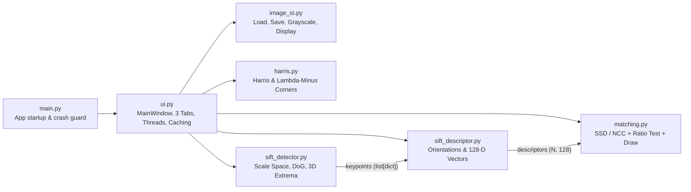

# Project Explainer — Feature Detection & Matching (CV Task 3)

Welcome to the plain-English guide for the **Feature Detection & Matching** desktop app (`features-matching-cv-task3`).  
This folder gives you an overall map of how the entire codebase fits together, followed by one explainer document per `.py` file where every class and function is broken down simply.

---

## 1. What the App Does

This is a **PyQt5 desktop application** with three interactive tabs, built from scratch using **NumPy** and **SciPy** (OpenCV is used *only* for image file I/O and drawing markers/lines):

| Tab | Title | What the user can do | Powered by |
|---|---|---|---|
| **1** | **Feature Detection** | Detect corners with **Harris** or **Lambda-Minus**, view corner overlays and a custom heatmap, tune `k`, `threshold`, and `window_size`. | [`harris.py`](../harris.py) |
| **2** | **SIFT Descriptors** | Build a Gaussian scale-space pyramid, compute DoG, find 3D scale-space keypoints, assign dominant orientations, and build 128-D descriptors. | [`sift_detector.py`](../sift_detector.py), [`sift_descriptor.py`](../sift_descriptor.py) |
| **3** | **Feature Matching** | Load two images, run SIFT on both, and match their 128-D descriptors using **SSD** or **NCC** with **Lowe's ratio test**. | [`matching.py`](../matching.py) |

---

## 2. How the 7 Python Files Connect

---

## 3. Core Conventions Shared Across Every File

Understanding these five conventions makes every file easy to read:

1. **Two image formats (display vs. math):**
   - **For loading & drawing (`(H, W, 3) uint8` RGB):** pixel values are `0–255` integers in RGB channel order. `image_io.load_image()` converts OpenCV's BGR into RGB immediately on load so all drawing code uses normal `(R, G, B)` colors.
   - **For all detectors & descriptors (`(H, W) float64` in `[0.0, 1.0]`):** `image_io.to_grayscale()` converts RGB to floating-point luminance before passing images to `harris.py`, `sift_detector.py`, or `sift_descriptor.py`. Working in `float64` avoids integer overflow and clipping during Sobel gradients and Gaussian blurs.

2. **Coordinate convention `(x, y)` vs. array indexing `[y, x]`:**
   - Stored keypoint coordinates are `(x, y)` where **`x` = column** (left → right) and **`y` = row** (top → bottom), matching OpenCV's `cv2.circle` / `cv2.line`.
   - When slicing a 2D NumPy array `img`, remember NumPy indexes `[row, col]`, i.e., `img[y, x]`.

3. **SIFT keypoint dictionary contract (between [`sift_detector.py`](../sift_detector.py) and [`sift_descriptor.py`](../sift_descriptor.py)):**
   Each detected SIFT keypoint is a Python `dict` with:
   - `'x'`, `'y'` — pixel position inside that octave's downsampled image.
   - `'x_img'`, `'y_img'` — `x * 2**octave`, `y * 2**octave` (position in the **original full-size image**).
   - `'octave'`, `'scale'` — pyramid level where the extremum was found.
   - `'sigma'` — blur scale in the octave's pixels (`sigma0 * k**scale`).
   - `'sigma_img'` — `sigma * 2**octave` (feature size in **original-image pixels**).
   - `'orientation'` — added later by `compute_orientations()` (`0–360°`).

   Keeping both octave coordinates and `_img` coordinates lets `sift_descriptor.py`, `ui.py`, and `matching.py` always index the original image cleanly without redoing scale conversions.

4. **Caching & Non-Blocking Background Threads ([`ui.py`](../ui.py)):**
   - Every heavy calculation runs inside a Python daemon thread via `run_in_background()` so the GUI never freezes.
   - **Tab 2** caches the Gaussian scale space and DoG pyramid. If you change *only* `kp_threshold`, it skips rebuilding the pyramid and only re-runs `detect_keypoints` + descriptors.
   - **Tab 3** caches `(keypoints, descriptors)` separately for Image 1 and Image 2. Changing the matching method (`SSD` ↔ `NCC`) or `ratio threshold` re-matches the stored descriptors in ~25 ms without re-running SIFT.

5. **No OpenCV / scikit-learn algorithm shortcuts:**
   - All Sobel/Gaussian/morphological filters, eigenvalue math, 3D extrema checks, descriptor histograms, and pairwise distance matrices are written in **NumPy** and **SciPy**. OpenCV (`cv2`) is strictly limited to decoding/encoding images (`imdecode`, `imencode`, `cvtColor`) and drawing primitives (`circle`, `line`).

---

## 4. Per-File Detailed Explainers

Click any file below to read an overall summary and a detailed, simple explanation of every single function and class inside it:

| Explainer | Source File | What's Covered |
|---|---|---|
| [main.md](./main.md) | [`main.py`](../main.py) | Uncaught exception hook, High-DPI setup, Fusion theme, launching `MainWindow` |
| [image_io.md](./image_io.md) | [`image_io.py`](../image_io.py) | Unicode-safe image load/save, luminance grayscale, float-to-uint8 normalization, Qt pixmap conversion |
| [harris.md](./harris.md) | [`harris.py`](../harris.py) | Structure tensor `M`, Harris response `R`, Lambda-minus `λ_min`, NMS + centroid tie merging |
| [sift_detector.md](./sift_detector.md) | [`sift_detector.py`](../sift_detector.py) | Incremental Gaussian scale-space pyramid, DoG layers, vectorized 26-neighbor 3D extrema detection |
| [sift_descriptor.md](./sift_descriptor.md) | [`sift_descriptor.py`](../sift_descriptor.py) | 36-bin dominant orientation, rotated 16×16 grid & angles, 4×4×8 histograms, L2-clip-L2 |
| [matching.md](./matching.md) | [`matching.py`](../matching.py) | Zero-row filtering, Lowe's ratio test, vectorized SSD & NCC distance matrices, side-by-side match drawing |
| [ui.md](./ui.md) | [`ui.py`](../ui.py) | Theme & heatmaps, background thread bridge, custom widgets (`ImageView`, `ParamSlider`, etc.), `_TabBase`, all 3 tabs & `MainWindow` |
