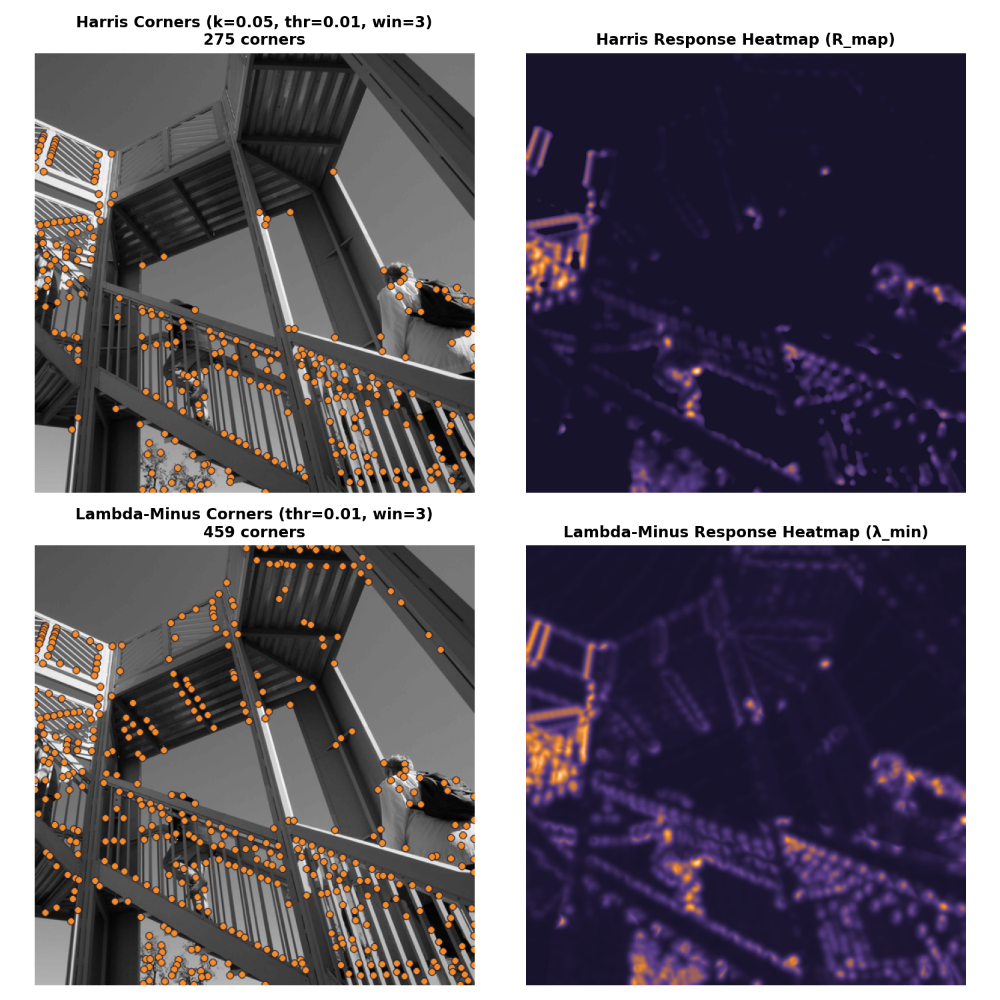
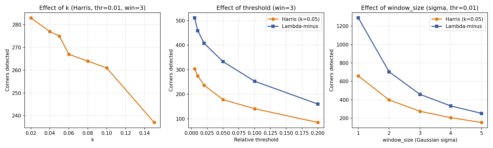

# Guide — Member B: Harris Corner Detection & Lambda-Minus

**Your file:** `harris.py`  
**Your notes:** this guide — keep it updated (rules below)

> ## ⚠️ Mandatory — keep this guide up to date
> 1. **Keep this guide in sync with your code.** If you change anything this guide describes — a formula, a step, a parameter, a function's behaviour — edit the concept explanation **and** the code skeleton here so they match what you actually did.
> 2. **Log every change** in the **Change Log** at the end of this guide: what you changed and why.
> 3. **Comment your code.** Every part of your file needs a brief comment saying what it computes and why. If a part has no comment, add one.
> 4. **Record your observations** (screenshots + what you noticed) in **Your Observations** at the end of this guide. There is no separate report file.


---

## Part 1 — Concepts: What You Must Understand

### 1.1 Why Corners?

Edges are places where brightness changes in one direction. Corners are places where brightness changes in **two directions at once** — that's what makes them useful. If you try to match a point that sits on a smooth edge, sliding along the edge gives you the same neighborhood — you can't tell where you are. A corner is unique: it looks different from every direction.

Harris formalizes this idea mathematically.

---

### 1.2 The Structure Tensor M

For every pixel, we look at the gradients `Ix` (horizontal gradient) and `Iy` (vertical gradient) of the image. Then we build a 2×2 matrix called the **structure tensor**:

```
M = Σ_window [ [Ix²,  Ix·Iy],
               [Ix·Iy, Iy² ] ]
```

The sum (Σ) is taken over a small neighborhood around the pixel (we weight it with a Gaussian). `M` captures how much the image is changing and in what direction in that local patch.

**What M's eigenvalues tell you:**

| λ1 (large) | λ2 (large) | Situation |
|------------|------------|-----------|
| Small | Small | Flat region — no gradient, no features |
| Large | Small | Edge — gradient in one direction only |
| Large | Large | **Corner** — gradient in both directions |

So detecting corners = finding pixels where **both eigenvalues are large**.

---

### 1.3 Harris Response R

Computing eigenvalues is expensive. Harris proposed a shortcut using two properties of a 2×2 matrix you can compute cheaply:

```
det(M)   = λ1 · λ2
trace(M) = λ1 + λ2
```

**Harris response:**
```
R = det(M) - k · trace(M)²
  = λ1·λ2 - k·(λ1+λ2)²
```

- `k` is a tuning constant, typically 0.04–0.06.
- **R >> 0** (large positive): corner ✓
- **R << 0** (large negative): edge
- **|R| ≈ 0**: flat region

**Why this works:** when both eigenvalues are large, `det(M)` is large and `trace(M)` doesn't penalize it too much. When one eigenvalue dominates (edge), `trace²` grows faster than `det`, making R negative.

**Step-by-step:**
1. Compute image gradients `Ix`, `Iy` with Sobel (no blur before this step)
2. Compute `Ix²`, `Iy²`, `Ix·Iy`
3. Smooth each of those three with a Gaussian window (this is the Σ in M)
4. Compute `R = Ixx·Iyy - Ixy² - k·(Ixx+Iyy)²`
5. Threshold: keep pixels where `R > threshold · max(R)`
6. **Required** (CLAUDE.md §4.6): apply non-maximum suppression (keep only local maxima), then merge tied neighbours into one point per corner (see 1.5)

---

### 1.4 Lambda-Minus Method

This is the "honest" version of Harris: instead of the approximation, we directly compute the **minimum eigenvalue** of M at every pixel and threshold it.

```
λ_min = (trace/2) - sqrt((trace/2)² - det)
```

A pixel is a corner if `λ_min > threshold · max(λ_min)`.

**Why λ_min?** A corner needs **both** eigenvalues to be large. The minimum eigenvalue is the bottleneck — if the smaller one is large, the larger one certainly is too.

**Comparison with Harris:**

| Aspect | Harris R | Lambda-Minus |
|--------|----------|--------------|
| Formula | `det - k·trace²` | `min(λ1, λ2)` |
| k constant | Yes (must tune) | No |
| Accuracy | Approximate | Exact |
| Speed | Slightly faster | Slightly slower (sqrt) |
| Response sign | Positive=corner, Negative=edge | Only positive meaningful |

Both detect the same corners in practice. Lambda-minus is "purer" conceptually.

---

### 1.5 Non-Maximum Suppression (NMS)

After computing R (or λ_min), many nearby pixels will all pass the threshold — you'd get a cluster of "corners" for each actual corner. NMS keeps only the local maximum in a small window (e.g., 3×3 or 5×5), giving one point per corner.

Simple approach: for each pixel, check if it's the maximum in its neighborhood. If not, suppress it.

**Ties (important):** on a perfectly symmetric corner (e.g. a synthetic checkerboard) several neighbouring pixels have exactly the same response, so they all equal the local maximum and plain NMS keeps all of them (4 points per corner instead of 1). Fix: after NMS, group the surviving pixels that touch each other (8-connectivity, `scipy.ndimage.label`) and keep one point per group at its centroid (`scipy.ndimage.center_of_mass`).

---

## Part 2 — Your File: harris.py

### What you implement

```python
import numpy as np
import scipy.ndimage
import time

def compute_structure_tensor(img, sigma=1.0, window_size=3):
    # 1. Compute Ix, Iy using Sobel (manual or scipy.ndimage.sobel) — directly on img
    #    (sigma stays in the signature for the UI, but is NOT used here)
    # 2. Compute Ix², Iy², Ix·Iy
    # 3. Smooth each with Gaussian (scipy.ndimage.gaussian_filter, sigma=window_size)
    # Returns: Ixx, Ixy, Iyy  — each is (H,W) float64

def harris_detection(img, k=0.05, threshold=0.01, window_size=3, sigma=1.0):
    # 1. t0 = time.perf_counter()
    # 2. Ixx, Ixy, Iyy = compute_structure_tensor(img, sigma, window_size)
    # 3. det_M = Ixx*Iyy - Ixy**2
    # 4. trace_M = Ixx + Iyy
    # 5. R = det_M - k * trace_M**2
    # 6. keypoints = pixels where R > threshold * R.max()
    # 7. Apply NMS + merge tied neighbours (_extract_keypoints)
    # 8. time_ms = (time.perf_counter() - t0) * 1000
    # Returns: R, keypoints, time_ms

def lambda_minus_detection(img, threshold=0.01, window_size=3, sigma=1.0):
    # 1. t0 = time.perf_counter()
    # 2. Ixx, Ixy, Iyy = compute_structure_tensor(img, sigma, window_size)
    # 3. trace_half = (Ixx + Iyy) / 2
    # 4. det_M = Ixx*Iyy - Ixy**2
    # 5. lambda_min = trace_half - np.sqrt(np.maximum(trace_half**2 - det_M, 0))
    # 6. keypoints = pixels where lambda_min > threshold * lambda_min.max()
    # 7. Apply NMS + merge tied neighbours (_extract_keypoints)
    # 8. time_ms = (time.perf_counter() - t0) * 1000
    # Returns: lambda_min, keypoints, time_ms
```

### Code skeleton with explanation

```python
import time

import numpy as np
import scipy.ndimage


def compute_structure_tensor(img, sigma=1.0, window_size=3):
    """Compute M = [[Ixx, Ixy],[Ixy, Iyy]] for every pixel."""
    # Work in float64 (Sobel on uint8 would overflow / clip).
    img = np.asarray(img, dtype=np.float64)

    # Standard Harris: Sobel directly on the image, no pre-blur.
    # `sigma` is kept in the signature so the UI call doesn't break, but unused.
    Ix = scipy.ndimage.sobel(img, axis=1)   # horizontal gradient
    Iy = scipy.ndimage.sobel(img, axis=0)   # vertical gradient

    # Products - the raw tensor components
    Ix2 = Ix * Ix
    Iy2 = Iy * Iy
    Ixy = Ix * Iy

    # Gaussian smoothing = the weighted sum (Σ) over the window in M.
    # window_size is used DIRECTLY as the Gaussian sigma (window_size=3 -> sigma=3).
    Ixx = scipy.ndimage.gaussian_filter(Ix2, sigma=window_size)
    Iyy = scipy.ndimage.gaussian_filter(Iy2, sigma=window_size)
    Ixy_smooth = scipy.ndimage.gaussian_filter(Ixy, sigma=window_size)

    return Ixx, Ixy_smooth, Iyy


def _nms(response_map, neighborhood=3):
    """True only where a pixel equals the max of its neighborhood window."""
    local_max = scipy.ndimage.maximum_filter(response_map, size=neighborhood)
    return response_map == local_max


def _extract_keypoints(response_map, threshold):
    """Relative threshold + NMS + merge ties -> list of (x, y) tuples."""
    max_val = response_map.max()
    # No positive peak (e.g. flat image) -> no corners.
    if max_val <= 0:
        return []

    # Relative threshold (not clipped before: negative R just fails the test).
    corners_mask = (response_map > threshold * max_val) & _nms(response_map)

    # Symmetric corners give several tied maxima that all survive NMS.
    # Group touching survivors (8-connectivity), keep one point per group
    # at its centroid -> exactly one keypoint per physical corner.
    labels, n = scipy.ndimage.label(corners_mask, structure=np.ones((3, 3), dtype=int))
    if n == 0:
        return []
    centers = scipy.ndimage.center_of_mass(corners_mask, labels, range(1, n + 1))

    # center_of_mass returns (row, col) -> store as (x=col, y=row)
    return [(int(round(c)), int(round(r))) for r, c in centers]


def harris_detection(img, k=0.05, threshold=0.01, window_size=3, sigma=1.0):
    t0 = time.perf_counter()

    Ixx, Ixy, Iyy = compute_structure_tensor(img, sigma, window_size)

    # det(M) = λ1·λ2, trace(M) = λ1+λ2 - no eigenvalues needed
    det_M   = Ixx * Iyy - Ixy ** 2
    trace_M = Ixx + Iyy
    R = det_M - k * trace_M ** 2        # >0 corner, <0 edge, ~0 flat

    keypoints = _extract_keypoints(R, threshold)

    time_ms = (time.perf_counter() - t0) * 1000.0
    return R, keypoints, time_ms


def lambda_minus_detection(img, threshold=0.01, window_size=3, sigma=1.0):
    t0 = time.perf_counter()

    Ixx, Ixy, Iyy = compute_structure_tensor(img, sigma, window_size)

    # Closed-form eigenvalues of the 2x2 matrix: λ = trace/2 ± sqrt((trace/2)² - det)
    trace_half = (Ixx + Iyy) / 2.0
    det_M      = Ixx * Iyy - Ixy ** 2
    # np.maximum(..., 0) prevents NaN from tiny negative values (float rounding)
    lambda_min = trace_half - np.sqrt(np.maximum(trace_half ** 2 - det_M, 0.0))

    # A corner needs BOTH eigenvalues large -> threshold the smaller one
    keypoints = _extract_keypoints(lambda_min, threshold)

    time_ms = (time.perf_counter() - t0) * 1000.0
    return lambda_min, keypoints, time_ms
```

---

## Part 3 — Order of Work

1. `git pull`, then `git checkout -b feature/harris`
2. Implement `compute_structure_tensor` — test on a chess-board image, the corners should light up.
3. Implement `harris_detection` — verify: `R > 0` at corners, `R < 0` on edges.
4. Implement `lambda_minus_detection` — both should find roughly the same corners.
5. Update this guide: fill in **Your Observations** and the **Change Log**, and check every part of your code has a brief comment.

---

## Part 4 — Prompts for Claude Code

- *"Read CLAUDE.md. I'm Member B. Implement harris.py exactly as in §6.2. Use scipy.ndimage for Sobel and Gaussian. No cv2.cornerHarris. Comment every step with what it computes and why."*
- *"Add a _nms function that keeps only local maxima using scipy.ndimage.maximum_filter. Use it inside both harris_detection and lambda_minus_detection."*

---

## Part 5 — Gotchas

- **Input is float64 in [0,1]** — do not pass uint8 to harris. `to_grayscale()` in image_io handles the conversion.
- **R can be negative** — don't clip before thresholding. Only clip for display.
- **Threshold is relative** — `threshold * R.max()`, not an absolute pixel value.
- **Watch for numerical noise in lambda_minus** — `trace_half² - det_M` can be slightly negative due to floating point. Use `np.maximum(..., 0)` before the sqrt.
- **NMS neighborhood size** — 3 is a good default; makes corners single points instead of blobs.
- **Tied maxima** — plain NMS (`response == local_max`) keeps every pixel that ties for the maximum. On a perfect synthetic checkerboard this gave 4 points per corner (196 instead of 49). `_extract_keypoints` merges touching survivors into one centroid point.
- **Flat image** — if `max(R) <= 0` there is no corner; `_extract_keypoints` returns an empty list instead of thresholding against a zero/negative max.
- **`sigma` is unused** — the only Gaussian smoothing is on Ix², Iy², Ix·Iy, using `window_size` (the Σ in M). `sigma` stays in the signature so the UI doesn't break, but changing it does not change the output. That is expected.

---

## Part 6 — What to Show in the Discussion (record it in **Your Observations** below)

- Harris response map (heatmap) on a checkerboard and on a real image
- Lambda-minus map on the same images
- Overlay of detected corners on the original image
- Effect of `k` on Harris (try 0.04, 0.05, 0.06)
- Effect of `threshold` on number of corners detected
- **Effect of `window_size` (sigma)** — try `window_size = 1, 2, 3` on the same image. Expect: larger sigma → broader, flatter R peaks → fewer but more robust corners, slightly less precise localization. Record the actual corner count at a fixed threshold for each.
- Timing comparison: Harris vs Lambda-minus

**Note on sigma and kernel size:** `window_size` is passed directly as `sigma` to `scipy.ndimage.gaussian_filter`. With `sigma=3`, the "2·sigma" radius covers ~6 px (≈95% of the Gaussian weight). `gaussian_filter` defaults to `truncate=4.0`, which means the actual kernel reaches `4·sigma = 12 px` each side — a 25×25 window. So `window_size=3` does not mean a 3×3 kernel; it means a large integration window that smooths the tensor heavily. This is expected and correct behavior. Mention this in the discussion so the TA knows you understand what the parameter actually controls.

## Checklist
- [x] `compute_structure_tensor` returns correct Ixx, Ixy, Iyy
- [x] No blur before Sobel; only Gaussian is on Ix², Iy², Ix·Iy with `window_size`
- [x] `harris_detection` returns R map, keypoints as (x,y), time_ms
- [x] `lambda_minus_detection` returns lmin map, keypoints, time_ms
- [x] NMS applied — single point per corner, not blobs
- [x] No cv2.cornerHarris used anywhere
- [x] This guide matches your final code; every change is in the **Change Log**
- [x] Every part of your code has a brief comment
- [x] **Your Observations** filled in with screenshots and notes

---

## Your Observations
_Measured on a synthetic 256×256 checkerboard (8×8 squares of 32 px → 49 inner corners). Add your own screenshots from the app on a real image where marked._

**Checkerboard results (measured)**

| Test | Result |
|------|--------|
| Corners expected | 49 |
| Harris corners found, `window_size` = 1 / 2 / 3 | 49 / 49 / 49 |
| Lambda-minus corners found, `window_size` = 1 / 2 / 3 | 49 / 49 / 49 |
| Harris vs Lambda-minus locations | identical |
| R at corners / on edges | R > 0 at corners; R min ≈ −0.86 on edges (max ≈ 8.9) |
| Harris time (avg of 20 runs, 256×256) | ≈ 10.9 ms |
| Lambda-minus time (avg of 20 runs, 256×256) | ≈ 9.4 ms |
| Effect of `k` (0.04 / 0.05 / 0.06) and `threshold` (0.001–0.5) | no change in count on the clean checkerboard (all 49) |

**What I noticed**
- Without merging tied maxima, plain NMS gave 196 points (4 per corner) because the response is exactly symmetric around a perfect corner. Merging touching survivors gives one point per corner (see Change Log).
- On a clean checkerboard the corner strength is so much larger than everything else that `k`, `threshold` and `window_size` don't change the count. These parameters only show their effect on a real, textured image.
- In this run Lambda-minus was slightly faster than Harris, but the difference is about 1 ms and within timing noise; both are the same order of magnitude. The extra `sqrt` in Lambda-minus did not make it noticeably slower.

**Real image results (measured on `512×512` architectural photo `scipy.datasets.ascent`)**





| Experiment (`512×512` real image) | Harris (`k=0.05`) | Lambda-minus |
|---|---|---|
| Default (`threshold=0.01`, `window_size=3`) | **275** corners | **459** corners |
| Effect of `k` (`0.04 / 0.05 / 0.06`, `thr=0.01, win=3`) | **277 / 275 / 267** corners | N/A (independent of `k`) |
| Effect of `threshold` (`0.005 / 0.01 / 0.02 / 0.05 / 0.10 / 0.20`, `win=3`) | **304 / 275 / 237 / 178 / 141 / 85** | **511 / 459 / 408 / 333 / 253 / 160** |
| Effect of `window_size` (`1 / 2 / 3 / 4 / 5`, `thr=0.01`) | **659 / 398 / 275 / 205 / 153** | **1290 / 704 / 459 / 333 / 252** |
| Average runtime (10 runs, `512×512`) | **196.51 ms** | **199.47 ms** |

**What I noticed on the real image:**
- **Harris vs. Lambda-minus at the same `threshold`:** Lambda-minus detects more corners than Harris (`459` vs `275` at `threshold=0.01`) because `R ≈ λ₁·λ₂` scales quadratically with gradient energy while `λ_min` scales linearly — so `0.01 × max(λ_min)` is a more permissive cutoff than `0.01 × max(R)`. Both heatmaps highlight the same strong architectural corners (window frames, railing intersections).
- **Effect of `k`:** Increasing `k` from `0.04` to `0.06` (and up to `0.15` → `237` corners) penalizes elongated edges (`trace²`) more heavily and steadily filters out borderline edge-like responses.
- **Effect of `window_size` (Gaussian `sigma`):** Increasing `window_size` from `1` to `5` smooths the structure tensor over a wider Gaussian neighborhood (`4σ` truncation radius), merging noisy micro-corners and dropping the Harris count from `659` to `153` while retaining only major structural corners.
- **Runtime:** Harris (`196.51 ms`) and Lambda-minus (`199.47 ms`) take virtually identical time on `512×512`, as the Sobel gradients, Gaussian smoothing, and NMS steps dominate over the per-pixel `sqrt`.

## Change Log
_Every change compared to the original guide (concept or code), and why._

| What changed | Why |
|--------------|-----|
| Added `_extract_keypoints()` that runs threshold + NMS, then merges touching survivors into one centroid point (`scipy.ndimage.label` + `center_of_mass`) | Plain NMS (`R == maximum_filter(R)`) keeps all tied maxima. On a perfect checkerboard it returned 196 points (4 per corner) instead of 49. |
| Both detectors now call `_extract_keypoints()` instead of building the mask inline | Removes duplicated code; same behaviour for Harris and Lambda-minus |
| Return an empty keypoint list when `max(R) <= 0` | A flat image has no positive peak; thresholding against a zero/negative max would be meaningless |
| `compute_structure_tensor` converts input with `np.asarray(img, dtype=np.float64)` | Prevents Sobel overflow/clipping if a uint8 image is passed by mistake |
| Added concept note on ties (1.5), updated step 6 and pseudo-code step 7, added two Gotchas, replaced the code skeleton | Keep the guide identical to the final code (Hard Rule 8) |
| Added real-image observations, parameter sweeps, timing comparison, and visual plots (`harris_real_comparison.png`, `harris_params_effect.png`) | Complete **Your Observations** (Checklist & Part 6) with verified measurements on a real `512×512` image |