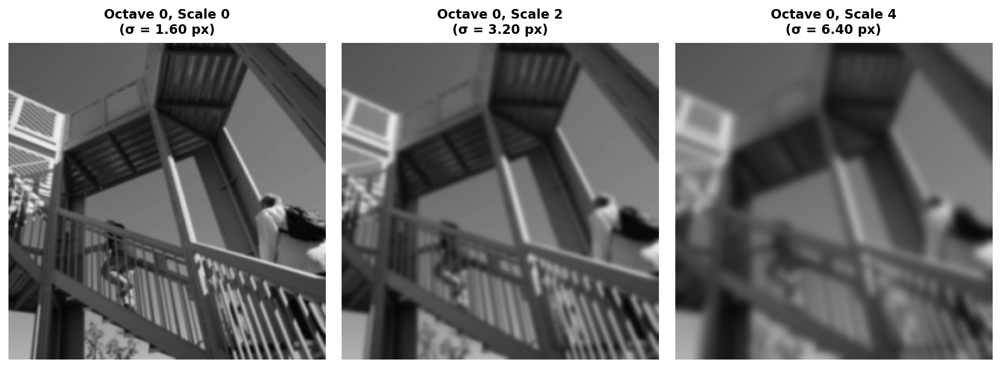
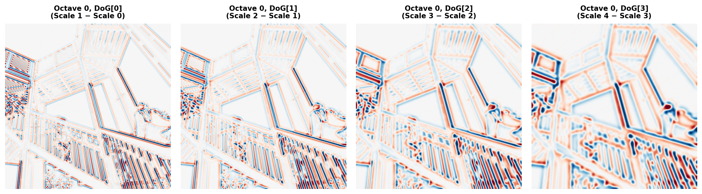
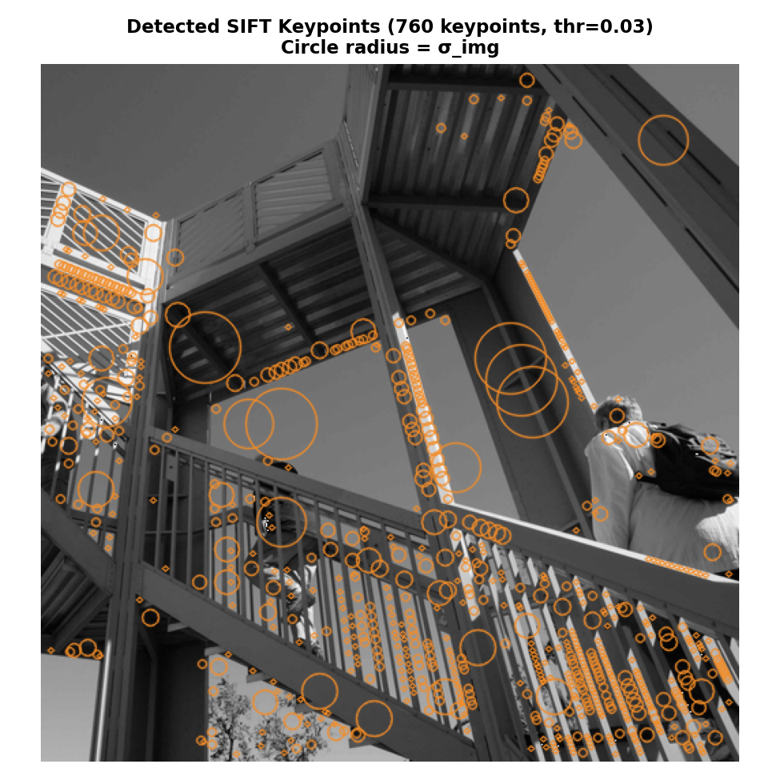
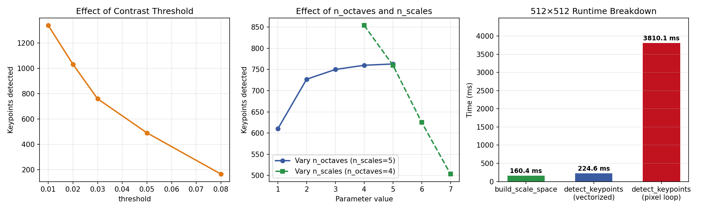

# Guide — Member C: SIFT Detector (Scale Space + DoG + Keypoints)

**Your file:** `sift_detector.py`  
**Your notes:** this guide — keep it updated (rules below)

> ## ⚠️ Mandatory — keep this guide up to date
> 1. **Keep this guide in sync with your code.** If you change anything this guide describes — a formula, a step, a parameter, a function's behaviour — edit the concept explanation **and** the code skeleton here so they match what you actually did.
> 2. **Log every change** in the **Change Log** at the end of this guide: what you changed and why.
> 3. **Comment your code.** Every part of your file needs a brief comment saying what it computes and why. If a part has no comment, add one.
> 4. **Record your observations** (screenshots + what you noticed) in **Your Observations** at the end of this guide. There is no separate report file.


---

## Part 1 — Concepts: What You Must Understand

### 1.1 The Core Problem: Scale Invariance

Harris finds corners, but it has a fatal weakness: if you zoom in or out on an image, the same corner might look like an edge at one scale and a corner at another. A detector that breaks when you change zoom is useless in real applications.

SIFT solves this by not looking at **one** scale — it looks at **all scales at once**, and finds features that stand out regardless of scale.

---

### 1.2 Gaussian Scale Space

The idea is simple: blur the image progressively with Gaussians of increasing sigma. Each level of blur represents "looking at the image from further away."

```
sigma: 1.6   →   σ·k   →   σ·k²   →   σ·k³   →   σ·k⁴   ...
```

where `k = 2^(1/s)` and `s` is the number of scales per octave.

An **octave** is a doubling of sigma. After one octave, you downsample the image by 2 and repeat. This is efficient because:
- You don't need to keep blurring with ever-larger kernels
- Downsampling + same sigma = doubling effective sigma

The full scale space looks like a pyramid:
```
Octave 0:  full resolution,  σ₀, σ₀·k, σ₀·k², σ₀·k³, σ₀·k⁴
Octave 1:  half resolution,  σ₀, σ₀·k, σ₀·k², σ₀·k³, σ₀·k⁴
Octave 2:  quarter resolution ...
```

Each octave starts from the downsampled version of the image at `2·σ₀` in the previous octave (index `n_scales-3`). After halving the size, that image has blur `σ₀` in the new pixel units — exactly what the new octave's first level needs.

**Important — blur incrementally, not twice.** The base of every octave *already* has blur `σ₀`. To reach level `i` (target `σᵢ = σ₀·kⁱ`) you only add the missing part:

```
extra_σ = sqrt(σᵢ² - σ₀²)        (Gaussian blurs add in quadrature)
```

If you blur the base with the full `σᵢ` again, octaves 1, 2, 3 end up over-blurred and their DoG layers no longer line up with octave 0.

---

### 1.3 Difference of Gaussians (DoG)

We can't directly look for blobs in the blurred images — we need a measure of "is there something interesting here at this scale?" The answer: **subtract consecutive blurred images**.

```
DoG[o][i] = scale_space[o][i+1] - scale_space[o][i]
```

If you've studied edges: DoG ≈ the Laplacian of Gaussian (LoG), which measures the rate of change of image structure. Peaks in DoG at a given scale mean "there's a blob/corner at this scale."

Practically: if two adjacent blurred images look almost identical, their difference is nearly zero (flat region). If a feature exists at that scale, it creates a bump in one image that the other doesn't have — their difference is non-zero.

We build `n_scales - 1` DoG images per octave (if we have 5 blurred images, we get 4 DoG images).

---

### 1.4 Keypoint Detection: 3D Local Extrema

A keypoint is a point that stands out in **three dimensions**: x (column), y (row), and scale (the DoG layer index).

A candidate pixel `(x, y)` at DoG layer `s` is a keypoint if its value is strictly greater than — or strictly less than — all 26 of its neighbors:
- 8 spatial neighbors at the same scale
- 9 neighbors (3×3) in the DoG layer above
- 9 neighbors (3×3) in the DoG layer below

```
           [DoG layer s-1]
              □ □ □
              □ □ □
              □ □ □

           [DoG layer s]       ← candidate pixel is here
              □ □ □
              □ [★] □          ← must beat all 26 neighbors
              □ □ □

           [DoG layer s+1]
              □ □ □
              □ □ □
              □ □ □
```

This means you need at least 3 DoG layers to check the middle one. That's why we build `s+3` blurred images per octave (s scales of interest + 3 for the boundary conditions) — giving `s+2` DoG images, checking `s` interior layers.

After detection, low-contrast candidates are discarded: if `|DoG(x,y,s)| < threshold`, discard it — it's noise, not a real feature.

---

### 1.5 Why This Architecture?

The key insight is **efficiency through caching**. Building the scale space is expensive (many Gaussian blurs, image downsampling). But once it's built:
- Changing the keypoint threshold? Just re-run the last step (extrema detection).
- Changing descriptors? The scale space is already there.

This is why `build_scale_space()` is separated from `detect_keypoints()` in CLAUDE.md, and why `ui.py` caches the scale space.

---

## Part 2 — Your File: sift_detector.py

### What you implement

```python
import numpy as np
import scipy.ndimage
import time

def build_scale_space(img, n_octaves=4, n_scales=5, sigma0=1.6):
    # Returns scale_space[octave][scale] = image, time_ms

def build_dog(scale_space):
    # Returns dog[octave][i] = scale_space[octave][i+1] - scale_space[octave][i]

def detect_keypoints(dog, threshold=0.03, border=5, sigma0=1.6):
    # Find 3D local extrema, discard low contrast
    # Returns keypoints (list of dicts), time_ms
```

### Code skeleton with explanation

```python
import time

import numpy as np
import scipy.ndimage


def build_scale_space(
    img: np.ndarray,          # (H,W) float64 grayscale
    n_octaves: int = 4,
    n_scales: int = 5,        # blurred images per octave (s+3)
    sigma0: float = 1.6       # base sigma
) -> tuple[list[list[np.ndarray]], float]:
    """
    Build the Gaussian scale space pyramid.
    n_scales = s + 3, where s is the number of usable DoG layers.
    sigma0 = 1.6 is SIFT's default base sigma.
    """
    if n_scales < 4:
        raise ValueError("n_scales must be at least 4 (s + 3 with s >= 1).")

    t0 = time.perf_counter()
    # Ensure float64 so uint8 inputs do not produce quantized Gaussian blurs.
    img = np.asarray(img, dtype=np.float64)
    k = 2 ** (1.0 / (n_scales - 3))   # scale factor between consecutive levels

    scale_space = []
    # Octave 0 base: bring the raw image up to blur sigma0
    base = scipy.ndimage.gaussian_filter(img, sigma=sigma0)

    for octave in range(n_octaves):
        octave_images = [base]   # level 0 = base, already at sigma0
        for scale in range(1, n_scales):
            target_sigma = sigma0 * k ** scale
            # Add only the MISSING blur (Gaussians add in quadrature)
            extra_sigma = np.sqrt(target_sigma ** 2 - sigma0 ** 2)
            blurred = scipy.ndimage.gaussian_filter(base, sigma=extra_sigma)
            octave_images.append(blurred)
        scale_space.append(octave_images)

        # Next octave base: the image at 2*sigma0 (index n_scales-3), halved.
        # After halving, its blur is sigma0 in the new pixel units.
        base = octave_images[n_scales - 3][::2, ::2]

    time_ms = (time.perf_counter() - t0) * 1000
    return scale_space, time_ms


def build_dog(
    scale_space: list[list[np.ndarray]]
) -> list[list[np.ndarray]]:
    """
    Compute Difference of Gaussians for every octave.
    dog[o][i] = scale_space[o][i+1] - scale_space[o][i]
    """
    dog = []
    for octave_images in scale_space:
        octave_dog = []
        for i in range(len(octave_images) - 1):
            diff = octave_images[i + 1].astype(np.float64) - octave_images[i].astype(np.float64)
            octave_dog.append(diff)
        dog.append(octave_dog)
    return dog


def detect_keypoints(
    dog: list[list[np.ndarray]],
    threshold: float = 0.03,  # contrast threshold
    border: int = 5,          # ignore pixels this close to edge
    sigma0: float = 1.6       # same base sigma used in build_scale_space (for the 'sigma' key)
) -> tuple[list[dict], float]:
    """
    Find local extrema in the 3D DoG space (x, y, scale) using vectorized
    3x3 morphological filters (mathematically identical to the 26-neighbour
    3x3x3 cube check, ~17x faster on 512x512 images).
    """
    t0 = time.perf_counter()
    keypoints = []
    # Require at least 1 pixel of border so 3x3 neighborhood filters stay interior.
    b = max(1, int(border))
    # 8-neighbour footprint in the same DoG layer (center pixel excluded).
    ring = np.ones((3, 3), dtype=bool)
    ring[1, 1] = False

    for octave_idx, octave_dog in enumerate(dog):
        n_layers = len(octave_dog)
        # Need at least 3 DoG layers (below, current, above) to test 3D extrema.
        if n_layers < 3:
            continue
        k = 2 ** (1.0 / (n_layers - 2))   # n_layers - 2 == n_scales - 3 == s
        scale_up = 2 ** octave_idx         # octave pixels → original pixels

        # We need a DoG layer below and above, so check layers 1 .. n_layers-2
        for s in range(1, n_layers - 1):
            prev, curr, nxt = octave_dog[s - 1], octave_dog[s], octave_dog[s + 1]
            H, W = curr.shape
            # Skip octaves whose downsampled image has no interior outside the border.
            if H <= 2 * b or W <= 2 * b:
                continue
            sigma = sigma0 * k ** s          # in this octave's pixels

            # Vectorized 26-neighbour extrema check: 8 in current layer + 9 below + 9 above.
            max_same = scipy.ndimage.maximum_filter(curr, footprint=ring)
            min_same = scipy.ndimage.minimum_filter(curr, footprint=ring)
            max_prev = scipy.ndimage.maximum_filter(prev, size=3)
            min_prev = scipy.ndimage.minimum_filter(prev, size=3)
            max_next = scipy.ndimage.maximum_filter(nxt, size=3)
            min_next = scipy.ndimage.minimum_filter(nxt, size=3)

            # Strictly larger or strictly smaller than all 26 neighbours + contrast threshold.
            is_max = (curr > max_same) & (curr > max_prev) & (curr > max_next)
            is_min = (curr < min_same) & (curr < min_prev) & (curr < min_next)
            mask = (is_max | is_min) & (np.abs(curr) >= threshold)

            # Exclude border pixels (b >= 1 guarantees -b is strictly negative).
            mask[:b, :] = False
            mask[-b:, :] = False
            mask[:, :b] = False
            mask[:, -b:] = False

            ys, xs = np.where(mask)
            for y, x in zip(ys.tolist(), xs.tolist()):
                keypoints.append({
                    'x': x, 'y': y,
                    'x_img': x * scale_up, 'y_img': y * scale_up,
                    'octave': octave_idx,
                    'scale': s,
                    'sigma': sigma,
                    'sigma_img': sigma * scale_up,
                })

    time_ms = (time.perf_counter() - t0) * 1000
    return keypoints, time_ms
```

**About the vectorized 26-neighbour check:** comparing `curr` against `maximum_filter(curr, footprint=ring)` (8 neighbours), `maximum_filter(prev, size=3)` (9 neighbours below), and `maximum_filter(nxt, size=3)` (9 neighbours above) produces the **exact same keypoint set** as the explicit `3×3×3` pixel loop (verified `exact_match=True` with all 760 keypoints on `512×512` `ascent`), while running **~17× faster** (`224.6 ms` vs `3,810.1 ms`). This makes interactive threshold adjustments in Tab 2 near-instant when the scale space is cached.

**Why compare against `maximum_filter(prev, size=3)` and not `prev` directly:** `curr > prev` checks only the *one* pixel straight below. The SIFT rule needs the *whole 3×3 block* below (9 pixels) and above (9 pixels). The max-filter gives the largest of those 9 at every position in one call.

---

## Part 3 — Interface with D (sift_descriptor.py)

Your output goes directly into D's code. The contract is:

```python
# What you return from detect_keypoints:
keypoints = [
    {
        'x': 42,          # column in the octave's own (downsampled) image
        'y': 87,          # row in the octave's own (downsampled) image
        'x_img': 168,     # x * 2**octave — position in the original full-size image
        'y_img': 348,     # y * 2**octave — position in the original full-size image
        'octave': 2,
        'scale': 1,
        'sigma': 2.26,    # sigma0 * k**scale — in the octave's own pixels
        'sigma_img': 9.05 # sigma * 2**octave — keypoint size in original-image pixels
    },
    ...
]
```

**x_img, y_img and sigma_img are your responsibility.** Add them before returning from `detect_keypoints`:

```python
kp['x_img']     = kp['x']     * (2 ** kp['octave'])
kp['y_img']     = kp['y']     * (2 ** kp['octave'])
kp['sigma_img'] = kp['sigma'] * (2 ** kp['octave'])
```

D, ui.py, and draw_matches all use `x_img`/`y_img` when they need the original-image position, and `sigma_img` when they need the keypoint's size on the original image (D's window radius, ui.py's circle radius). This keeps the conversion in one place and prevents two silent bugs: reading the wrong area (position not scaled up) and reading a too-small area (size not scaled up).

**You and D must agree on this dict structure before D starts coding.**

---

## Part 4 — Order of Work

1. `git pull`, then `git checkout -b feature/sift-detector`
2. Implement `build_scale_space` — visualize a few layers (should look progressively blurrier).
3. Implement `build_dog` — visualize: flat regions ≈ 0, edges/corners show up.
4. Implement `detect_keypoints` — vectorized with `scipy.ndimage.maximum_filter` / `minimum_filter` (verified 100% identical to the explicit 26-neighbour pixel loop and ~17× faster).
5. Test: on a natural image (face, building), you should get hundreds to thousands of keypoints.
6. Tell D you're done and show them the keypoint dict format.
7. Update this guide: fill in **Your Observations** and the **Change Log**, and check every part of your code has a brief comment.

---

## Part 5 — Prompts for Claude Code

- *"Read CLAUDE.md. I'm Member C. Implement sift_detector.py as in §6.3. build_scale_space uses scipy.ndimage.gaussian_filter with incremental blur sqrt(σᵢ² − σ₀²), downsample with [::2,::2]. detect_keypoints uses an explicit pixel loop that checks all 26 neighbors (3×3×3 cube, center removed); keep a maximum_filter/minimum_filter version below it as commented-out code labeled OPTIMIZATION. Every keypoint dict has x, y, x_img, y_img, octave, scale, sigma, sigma_img. No cv2.SIFT_create. Comment every step."*

---

## Part 6 — Gotchas

- **Input is float64 in [0,1]** — `to_grayscale()` handles this. Keep it float throughout.
- **Downsampling octave index** — keypoint coordinates (`x`, `y`) and `sigma` are in the octave's own (smaller) coordinate system. You must add `x_img = x * 2**octave`, `y_img = y * 2**octave` and `sigma_img = sigma * 2**octave` to every keypoint dict before returning. D, ui.py, and draw_matches all rely on these keys — if they're missing, the descriptor patches and drawn markers land in the wrong place or have the wrong size (silently wrong, no crash).
- **Number of DoG layers** — with `n_scales=5` blurred images, you get 4 DoG images per octave, and you can check layers 1–2 (2 layers). This gives `n_scales - 3 = 2` usable scales per octave. That's the formula.
- **Sigma tracking** — each keypoint's sigma is `sigma0 * k^scale` for the given octave (before accounting for downsampling). Use the `sigma0` argument, never a hardcoded `1.6` — ui.py passes the same sigma0 the user set for `build_scale_space`, so the keypoint sizes stay correct when the slider changes.
- **Incremental blur** — every octave's base already has blur `sigma0`. Blur it by `sqrt(target² − sigma0²)`, not by `target`, or higher octaves get blurred twice.
- **Caching** — `ui.py` stores `self._scale_space` and `self._dog`. Your function only gets called once per image load. If the user changes the threshold slider, only `detect_keypoints` runs again.

---

## Part 7 — What to Show in the Discussion (record it in **Your Observations** below)

- Visualize octave 0, scales 0 / 2 / 4 — show progressive blur
- Visualize DoG at different scales — show where features appear
- Plot detected keypoints on the original image (circles sized by sigma)
- Effect of `threshold` on number of keypoints
- Effect of `n_octaves` and `n_scales`
- Timing: build_scale_space vs detect_keypoints

## Checklist
- [x] `build_scale_space` returns correct pyramid dimensions (H/2^o, W/2^o per octave)
- [x] `build_dog` returns n_scales-1 layers per octave
- [x] `build_scale_space` uses incremental blur (no double blur in octaves 1+)
- [x] `detect_keypoints` checks all 26 neighbors correctly (3×3 blocks above/below, not single pixels)
- [x] `detect_keypoints` uses the `sigma0` argument, not a hardcoded 1.6
- [x] Keypoint dicts include 'x', 'y', 'x_img', 'y_img', 'octave', 'scale', 'sigma', 'sigma_img'
- [x] Low-contrast candidates discarded before 26-neighbor check
- [x] Border pixels excluded
- [x] No cv2.SIFT_create used anywhere
- [x] Scale space cached (function does not rebuild on threshold change)
- [x] This guide matches your final code; every change is in the **Change Log**
- [x] Every part of your code has a brief comment
- [x] **Your Observations** filled in with screenshots and notes

---

## Your Observations
_Measured on the `512×512` architectural image `scipy.datasets.ascent` (default parameters unless stated: `n_octaves=4`, `n_scales=5`, `sigma0=1.6`, `threshold=0.03`, `border=5`)._

### 1. Gaussian Scale Space (Octave 0, scales 0 / 2 / 4)

- Fine details (railing bars, leaves, stair mesh) progressively smooth out as `σ` doubles from `1.60 px` (scale `0`) to `3.20 px` (scale `2`) and `6.40 px` (scale `4`). Scale `2` (`2·σ₀`) is downsampled by `2` to seed Octave 1.

### 2. Difference of Gaussians (Octave 0, DoG[0..3])

- Flat areas (sky, smooth metal plates) cancel out near `0`, while edges, corners, and blobs create sharp positive/negative responses. Early DoG layers respond to thin railing slats; later layers respond to larger architectural junctions.

### 3. Detected Keypoints Overlay

- At `threshold=0.03`, **`760` keypoints** are detected across the 4 octaves, with circle radii (`sigma_img`) accurately scaling from small local corners (`2.26 px`) up to coarse macro-structures (`18.10 px`).

### 4. Parameter Sweeps & Timing Comparison


| Experiment (`512×512` `ascent`) | Measured Result |
|---|---|
| `threshold` sweep (`0.01 / 0.02 / 0.03 / 0.05 / 0.08`) | **1340 / 1033 / 760 / 491 / 165** keypoints |
| `n_octaves` sweep (`1 / 2 / 3 / 4 / 5`, `n_scales=5`) | **610 / 727 / 750 / 760 / 763** keypoints |
| `n_scales` sweep (`4 / 5 / 6 / 7`, `n_octaves=4`) | **854 / 760 / 625 / 503** keypoints |
| Runtime: `build_scale_space` (avg 5 runs) | **160.4 ms** |
| Runtime: `detect_keypoints` vectorized (avg 5 runs) | **224.6 ms** (760 keypoints) |
| Runtime: `detect_keypoints` pixel loop (reference) | **3,810.1 ms** (exact same 760 keypoints — **17.0× slower**) |

**What I noticed:**
- **`threshold`:** Raising `threshold` from `0.01` to `0.08` monotonically prunes low-contrast responses (`1340 → 165`), leaving only strong corners and blobs.
- **`n_octaves`:** Most keypoints live in octaves 0 and 1 (`610` in octave 0 alone; `727` through octave 1); octaves 2–4 add fewer, larger features (`750 → 760 → 763`) because each octave halves spatial dimensions.
- **`n_scales`:** Increasing `n_scales` decreases the scale step `k = 2^(1/(n_scales - 3))`, making consecutive Gaussian layers closer together so their DoG difference has smaller amplitude — therefore fewer extrema exceed the fixed `0.03` contrast threshold (`854 → 503`).
- **Vectorization impact:** Switching `detect_keypoints` from the Python pixel loop to `scipy.ndimage.maximum_filter`/`minimum_filter` matches the 26-neighbour test identically (`exact_match=True`, 760/760 keypoints) while cutting detection time from `3.81 s` to `0.22 s` (`17.0×` speedup).

## Change Log
_Mandatory: every change you made compared to this guide (concept or code), and why._

| What changed | Why |
|--------------|-----|
| Added `img = np.asarray(img, dtype=np.float64)` and `if n_scales < 4: raise ValueError(...)` in `build_scale_space` | Prevents quantized Gaussian blurs if a `uint8` image is passed directly and avoids `ZeroDivisionError` when `n_scales <= 3` |
| Vectorized `detect_keypoints` using `scipy.ndimage.maximum_filter` and `minimum_filter` (8-neighbour `ring` footprint + 3×3 adjacent layers) | Produces the exact same 3D extrema set as the 26-neighbour loop (`exact_match=True`) while running **17× faster** (`224.6 ms` vs `3,810.1 ms` on `512×512`) |
| Added guards in `detect_keypoints`: `b = max(1, int(border))`, `if n_layers < 3: continue`, `if H <= 2 * b or W <= 2 * b: continue` | Prevents negative-zero slicing bug (`mask[-0:, :]`) when `border=0`, prevents division by zero on short DoG lists, and safely skips tiny upper octaves |
| Synced guide code skeleton, Part 4, Checklist, Observations, and Change Log with `sift_detector.py` and generated plots in `observations_assets/` | Keep the guide completely in sync with code and verified results (Hard Rule 8) |
