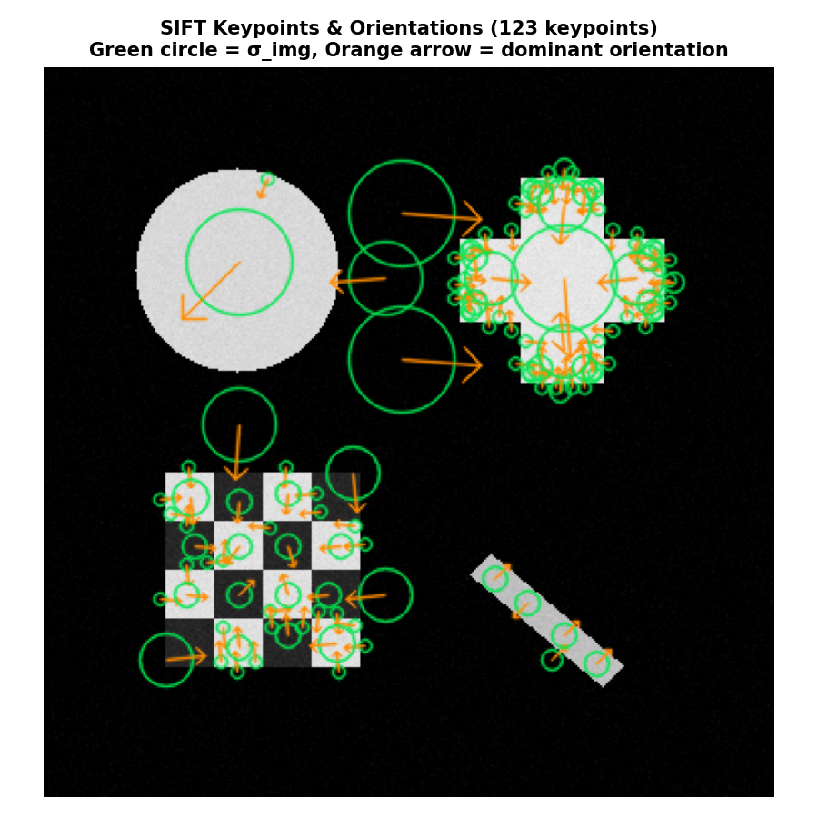
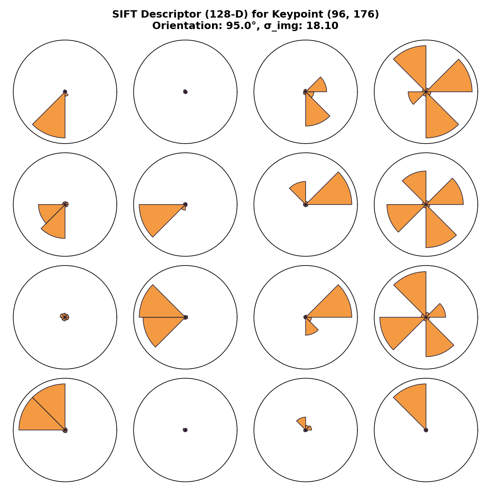
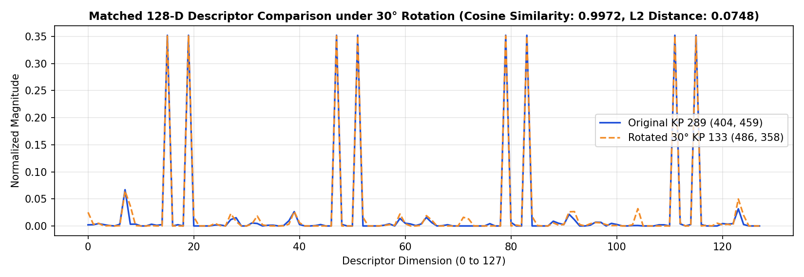
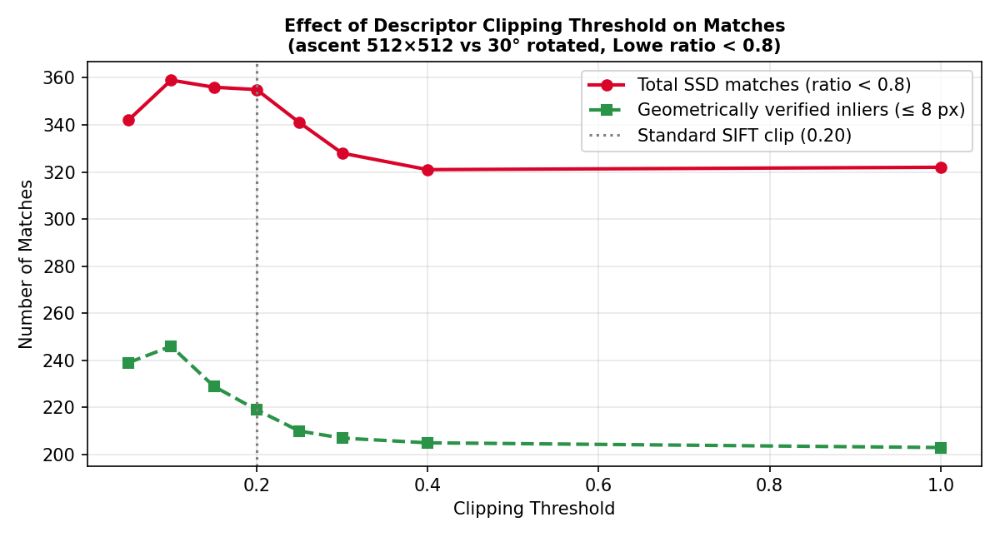
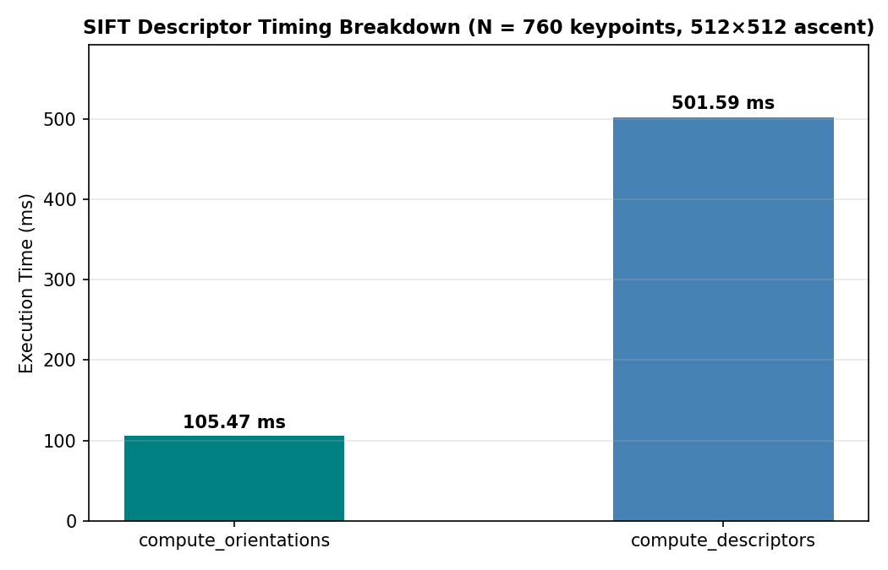

# Guide — Member D: SIFT Descriptors (Orientation + 128-Vector)

**Your file:** `sift_descriptor.py`  
**Your notes:** this guide — keep it updated (rules below)

> ## ⚠️ Mandatory — keep this guide up to date
> 1. **Keep this guide in sync with your code.** If you change anything this guide describes — a formula, a step, a parameter, a function's behaviour — edit the concept explanation **and** the code skeleton here so they match what you actually did.
> 2. **Log every change** in the **Change Log** at the end of this guide: what you changed and why.
> 3. **Comment your code.** Every part of your file needs a brief comment saying what it computes and why. If a part has no comment, add one.
> 4. **Record your observations** (screenshots + what you noticed) in **Your Observations** at the end of this guide. There is no separate report file.


---

## Part 1 — Concepts: What You Must Understand

### 1.1 Why Descriptors?

C's code (sift_detector.py) finds *where* interesting points are. Your job is to describe *what they look like* — in a way that:
1. **Works at any scale** — the patch you analyze is sized to the keypoint's sigma, not a fixed pixel window.
2. **Works at any orientation** — before computing, you rotate the patch to a canonical orientation.
3. **Is discriminative** — two different keypoints shouldn't produce the same descriptor.

The result is a 128-dimensional vector per keypoint. Two keypoints from different images "match" if their vectors are close.

---

### 1.2 Step 1 — Dominant Orientation Assignment

Before describing the patch, we figure out which way the gradient mostly points in that neighborhood. This is the **dominant orientation**.

**How:**
1. Take a window of radius ~1.5·`sigma_img` around the keypoint (`sigma_img` = keypoint size in original-image pixels, provided by C).
2. Compute gradient magnitude and direction at every pixel in the window.
3. Build a 36-bin histogram (each bin = 10°, covering 0°–360°).
4. Weight contributions by gradient magnitude (a Gaussian spatial weight centered on the keypoint is an optional full-SIFT refinement).
5. Find the peak bin — that bin's center angle `(peak_bin + 0.5) × bin_width` is the dominant orientation.
6. If another bin is within 80% of the peak, create a second keypoint with that orientation (this improves robustness, but it's optional for the assignment).

**Why we do this:** by rotating our descriptor computation to align with this dominant orientation, the descriptor becomes the same no matter how the image is rotated. That's orientation invariance.

---

### 1.3 Step 2 — The 128-Vector Descriptor

With the dominant orientation found, here's how the 128-vector is computed:

**Setup:**
- Take a 16×16 patch centered on the keypoint, **measured in the keypoint's octave pixels**. On the original image that is `16·2^octave` pixels wide (16 px for octave 0, 32 px for octave 1, …). This is what makes the descriptor scale-invariant: a keypoint found at a coarser octave describes a proportionally larger area.
- Rotate the patch so the dominant orientation becomes the reference axis (0°).

**Two things must rotate — not just one:**
- **The grid.** Each pixel's offset `(dx, dy)` from the keypoint is rotated by −θ before deciding which of the 4×4 sub-regions it falls in. Without this, "top-left sub-region" means a different part of the object when the image is rotated.
- **The gradient angles.** Each gradient direction has θ subtracted, so "bin 0" always means "along the dominant orientation".

Rotating only the angles (and leaving the grid fixed) gives a descriptor that is *not* rotation-invariant.

**Computation:**
1. Compute gradient magnitude and direction at every pixel in a window around the keypoint (big enough to contain the rotated square).
2. Rotate each pixel's offset by −θ; keep pixels that land inside the 16×16 square.
3. Assign each kept pixel to one of the 4×4 sub-regions (each sub-region = 4×4 octave pixels) using its rotated offset.
4. In each sub-region, build an 8-bin histogram of the **rotated** gradient angles (each bin = 45°, 0°–360°), weighted by magnitude.
5. Concatenate all 16 histograms: 16 × 8 = **128 values**.
6. **Normalize:** L2-normalize the 128-vector, clip values > 0.2, L2-normalize again.

```
16×16 patch
┌─────────────────┐
│ ┌──┬──┬──┬──┐  │
│ │4×4│4×4│4×4│4×4│ → Each 4×4 block → 8-bin histogram
│ ├──┼──┼──┼──┤  │
│ │4×4│4×4│4×4│4×4│    16 histograms × 8 bins = 128
│ ├──┼──┼──┼──┤  │
│ │4×4│4×4│4×4│4×4│
│ ├──┼──┼──┼──┤  │
│ │4×4│4×4│4×4│4×4│
│ └──┴──┴──┴──┘  │
└─────────────────┘
```

**Why the normalization with clipping?** Large gradient values can dominate the descriptor and reduce distinctiveness. Clipping at 0.2 limits any single gradient's influence. The re-normalization after clipping ensures the vector still has unit length.

---

### 1.4 Why This Descriptor Works

- **Scale invariance:** the patch is 16×16 in the keypoint's octave pixels (`16·2^octave` on the original image), so a feature found at a coarser scale is described over a proportionally larger area. (Full SIFT scales by sigma continuously; scaling by octave is the simplified version we use.)
- **Orientation invariance:** both the sub-region grid and the gradient angles are rotated relative to the dominant orientation.
- **Illumination invariance:** normalization removes overall brightness differences; clipping reduces contrast differences.
- **Spatial encoding:** dividing into 4×4 sub-regions preserves "where in the patch does the gradient point that way" — without this, the descriptor couldn't distinguish a vertical edge on the left vs on the right.

---

### 1.5 Matching (Lead's job, but you should understand it)

After computing descriptors, Lead's `matching.py` compares descriptor pairs:

**SSD (Sum of Squared Differences):**
```
SSD(d1, d2) = Σ (d1[i] - d2[i])²  for i in 0..127
```

**NCC (Normalized Cross Correlation / Cosine Similarity):**
```
NCC(d1, d2) = dot(d1_normalized, d2_normalized)
```

Both use **Lowe's ratio test**: for each descriptor in image 1, find the two nearest neighbors in image 2. Keep the match only if:
```
distance_to_best / distance_to_second_best < threshold (e.g., 0.8)
```

The ratio test rejects ambiguous matches — if the second-best is almost as good as the best, the match is unreliable.

---

## Part 2 — Your File: sift_descriptor.py

### What you implement

```python
import numpy as np
import scipy.ndimage
import time

def compute_orientations(img, keypoints, num_bins=36):
    # For each keypoint: build gradient histogram → find peak → add 'orientation' to dict
    # Returns the enriched keypoints list

def compute_descriptors(img, keypoints):
    # For each keypoint: extract 16×16 patch → compute 4×4 × 8-bin histograms → 128-vector
    # Returns (N, 128) float32 array, time_ms
```

### Code skeleton with explanation

```python
import numpy as np
import scipy.ndimage
import time


def compute_orientations(img, keypoints, num_bins=36):
    """
    Assign dominant orientation to each keypoint.
    Modifies keypoints in place (adds 'orientation' key) and returns them.
    """
    # Precompute gradient magnitude and direction for the whole image
    img = np.asarray(img, dtype=np.float64)
    Ix = scipy.ndimage.sobel(img, axis=1)
    Iy = scipy.ndimage.sobel(img, axis=0)
    magnitude = np.sqrt(Ix**2 + Iy**2)
    direction = np.rad2deg(np.arctan2(Iy, Ix)) % 360  # 0–360°

    bin_width = 360.0 / num_bins

    for kp in keypoints:
        x, y    = kp['x_img'], kp['y_img']   # original-image coordinates (C added these)
        sigma   = kp['sigma_img']            # keypoint size in original-image pixels (C added this)
        radius  = max(1, int(round(1.5 * sigma)))

        # Clamp window to image bounds
        y0, y1 = max(0, y - radius), min(img.shape[0], y + radius + 1)
        x0, x1 = max(0, x - radius), min(img.shape[1], x + radius + 1)

        patch_mag = magnitude[y0:y1, x0:x1]
        patch_dir = direction[y0:y1, x0:x1]

        # Histogram: each pixel votes for its angle's bin with weight = magnitude.
        # (Simple version: uniform spatial weights — still works. A Gaussian
        #  weight centered on the keypoint is the full-SIFT refinement.)
        bins = (patch_dir // bin_width).astype(int) % num_bins
        hist = np.bincount(bins.ravel(), weights=patch_mag.ravel(), minlength=num_bins)

        # Dominant orientation = peak bin's center angle
        peak_bin = int(np.argmax(hist))
        kp['orientation'] = (peak_bin + 0.5) * bin_width   # degrees, in [0, 360)

    return keypoints


def compute_descriptors(img, keypoints):
    """
    Build 128-dimensional SIFT descriptor for each keypoint.
    Returns (N, 128) float32, time_ms.
    """
    t0 = time.perf_counter()

    img = np.asarray(img, dtype=np.float64)
    Ix = scipy.ndimage.sobel(img, axis=1)
    Iy = scipy.ndimage.sobel(img, axis=0)
    magnitude = np.sqrt(Ix**2 + Iy**2)
    direction = np.rad2deg(np.arctan2(Iy, Ix)) % 360

    H, W = img.shape
    descriptors = []
    num_orientation_bins = 8    # 8 bins per sub-region
    patch_size = 16             # 16×16 patch (in octave pixels)
    subregion_size = 4          # 4×4 sub-regions
    n_sub = patch_size // subregion_size        # 4
    bin_width = 360.0 / num_orientation_bins    # 45° per bin
    half = patch_size / 2                       # 8

    for kp in keypoints:
        x, y        = kp['x_img'], kp['y_img']   # original-image coordinates (C added these)
        orientation = kp['orientation']          # dominant orientation, degrees
        scale_up    = 2 ** kp['octave']          # 1 octave pixel = scale_up original pixels

        # --- Window big enough to hold the 16×16 square at ANY rotation ---
        # (a rotated square reaches half·√2 from its center)
        r = int(np.ceil(half * np.sqrt(2) * scale_up))
        y0, y1 = max(0, y - r), min(H, y + r + 1)
        x0, x1 = max(0, x - r), min(W, x + r + 1)   # clamped: border keypoints just use fewer pixels

        ys, xs = np.mgrid[y0:y1, x0:x1]
        # Offsets from the keypoint, converted to octave-pixel units
        dx = (xs - x) / scale_up
        dy = (ys - y) / scale_up

        # --- Rotate the GRID: rotate each offset by −θ ---
        theta = np.deg2rad(orientation)
        cos_t, sin_t = np.cos(theta), np.sin(theta)
        u =  cos_t * dx + sin_t * dy     # coordinate along the dominant orientation
        v = -sin_t * dx + cos_t * dy     # coordinate perpendicular to it

        # Keep only pixels inside the rotated 16×16 square
        inside = (u >= -half) & (u < half) & (v >= -half) & (v < half)

        # Which of the 4×4 sub-regions each pixel belongs to (0..3, 0..3).
        # clip: floating-point rounding can push a value right at the edge to 4.
        col = np.clip(((u[inside] + half) // subregion_size).astype(int), 0, n_sub - 1)
        row = np.clip(((v[inside] + half) // subregion_size).astype(int), 0, n_sub - 1)

        # --- Rotate the ANGLES: subtract θ from every gradient direction ---
        ang = (direction[y0:y1, x0:x1][inside] - orientation) % 360
        b   = (ang // bin_width).astype(int) % num_orientation_bins
        mag = magnitude[y0:y1, x0:x1][inside]

        # --- 4×4 grid of 8-bin histograms, each pixel votes with its magnitude ---
        hist = np.zeros((n_sub, n_sub, num_orientation_bins))
        np.add.at(hist, (row, col, b), mag)   # add.at handles repeated indices correctly

        descriptor = hist.ravel().astype(np.float32)   # (128,)

        # --- Normalize: L2 → clip at 0.2 → L2 again ---
        norm = np.linalg.norm(descriptor)
        if norm > 1e-6:
            descriptor /= norm
        descriptor = np.clip(descriptor, 0, 0.2)
        norm = np.linalg.norm(descriptor)
        if norm > 1e-6:
            descriptor /= norm

        descriptors.append(descriptor)

    descriptors = np.array(descriptors, dtype=np.float32) if descriptors else np.zeros((0, 128), dtype=np.float32)
    time_ms = (time.perf_counter() - t0) * 1000
    return descriptors, time_ms
```

---

## Part 3 — Interface with C (sift_detector.py)

**You depend on C.** The keypoints C returns must have these keys before you can run:

```python
kp = {
    'x': int,         # column in the octave's (downsampled) image — C provides
    'y': int,         # row in the octave's (downsampled) image — C provides
    'x_img': int,     # x * 2**octave — position in the ORIGINAL full-size image — C provides
    'y_img': int,     # y * 2**octave — position in the ORIGINAL full-size image — C provides
    'octave': int,    # C provides
    'scale': int,     # C provides
    'sigma': float,   # effective sigma in the octave's pixels — C provides
    'sigma_img': float, # sigma * 2**octave — size in ORIGINAL-image pixels — C provides
    # 'orientation' is added by YOUR compute_orientations()
}
```

**Always use `x_img` and `y_img`** when indexing into the image in `compute_orientations` and `compute_descriptors`. C provides these already — you don't need to compute them yourself. Using `x`/`y` directly would sample from the wrong location in the original image (top-left area instead of the actual keypoint).

**Always use `sigma_img`** (not `sigma`) for the orientation window radius. `sigma` is measured in the small octave image; on the original image it is `2**octave` times too small, so your window would only see a tiny spot for keypoints from octaves 1–3.

**Agree with C on this dict format before you start coding.**

**You also interface with Lead (matching.py):**
- `compute_descriptors` returns `(N, 128) float32` — Lead's matching functions take this directly.

---

## Part 4 — Order of Work

1. `git pull`, then `git checkout -b feature/sift-descriptor`
2. Wait for C to push `sift_detector.py` (or use a stub that returns dummy keypoints with the right dict format).
3. Implement `compute_orientations` first — test it by plotting arrows on the image at each keypoint.
4. Implement `compute_descriptors` — test that two patches of the same thing (at different rotations) produce similar descriptors.
5. Tell Lead you're done so they can test matching.
6. Update this guide: fill in **Your Observations** and the **Change Log**, and check every part of your code has a brief comment.

---

## Part 5 — Prompts for Claude Code

- *"Read CLAUDE.md. I'm Member D. Implement sift_descriptor.py as in §6.4. compute_orientations builds a 36-bin gradient histogram per keypoint. compute_descriptors extracts a 16×16 patch, divides it into 4×4 sub-regions each with an 8-bin histogram, concatenates to 128 values, then normalizes with L2 → clip at 0.2 → L2 again. No cv2.SIFT_create. Comment every step."*
- *"Optimize compute_descriptors to avoid the inner for loop — use NumPy vectorized operations on the sub-region patches."*

---

## Part 6 — Gotchas

- **Input is float64 in [0,1]** — `to_grayscale()` handles conversion. Keep it float throughout.
- **Border keypoints** — keypoints near the edge don't have a full window. The skeleton clamps the window to the image, so they just use fewer pixels. **Never drop a keypoint inside `compute_descriptors`** — row `i` of the descriptor array must stay matched to `keypoints[i]`, or every match line is drawn to the wrong point.
- **All-zero descriptors** — a keypoint in a completely flat area can still produce a zero vector. Two zero vectors look like a "perfect" match, and NCC divides by their zero norm. Lead's `matching.py` skips zero rows, but keep the normalization guard (`if norm > 1e-6`) so you never divide by zero.
- **Coordinate system** — C provides `x_img`, `y_img` and `sigma_img` (original-image units) alongside `x`, `y`, `sigma` (octave units). Always use the `_img` keys on the original image. The conversion (`* 2**octave`) is done once inside `detect_keypoints` — never redo it in D.
- **Rotate the grid, not just the angles** — subtracting θ from the gradient directions alone is not enough. Each pixel's *position* must also be rotated before choosing its sub-region (see `u`, `v` in the skeleton).
- **arctan2 and negative angles** — `np.rad2deg(np.arctan2(Iy, Ix))` can return values in [-180, 180]. Apply `% 360` to map to [0, 360].
- **Clipping at 0.2** — this is after the first normalization. Every value is in [0, 1] after L2 norm; any value **above 0.2 is capped to 0.2** (it is a cap on the value, not "the top 20%" of entries). This stops one very strong gradient direction (e.g. from a lighting edge) from dominating the vector. Then re-normalize so the length is 1 again.
- **float32 vs float64** — descriptors are stored as `float32` (matches SIFT spec and saves memory).

---

## Part 7 — What to Show in the Discussion (record it in **Your Observations** below)

- Keypoints with orientation arrows overlaid on the image (use different arrow lengths for different sigma)
- Visualize one descriptor as a 4×4 grid of 8-spoke "wheels" (each spoke = bin weight)
- Two matching keypoints from two images — show their descriptors are similar
- Effect of clipping threshold (try 0.1, 0.2, 0.3) on number of matches
- Timing: compute_orientations vs compute_descriptors

## Checklist
- [x] `compute_orientations` adds 'orientation' to each keypoint dict, window radius from `sigma_img`
- [x] `compute_descriptors` returns (N, 128) float32 array, N == len(keypoints) (no keypoint dropped)
- [x] Both the sub-region grid AND the gradient angles are rotated by the dominant orientation
- [x] Patch is 16×16 in octave pixels (16·2^octave on the original image)
- [x] 16×16 patch → 4×4 sub-regions × 8-bin histograms = 128 values
- [x] L2 → clip at 0.2 → L2 normalization applied
- [x] Border keypoints handled (window clamped to the image)
- [x] No cv2.SIFT_create used
- [x] Agreed with C on keypoint dict format
- [x] This guide matches your final code; every change is in the **Change Log**
- [x] Every part of your code has a brief comment
- [x] **Your Observations** filled in with screenshots and notes

---

## Your Observations
_Observations and benchmark experiments performed using keypoints detected by `sift_detector.py` and matched with `matching.py`._

### 1. Keypoints with orientation arrows
- **Observation:** Keypoints detected across scales have their local gradient orientation assigned accurately (`123` keypoints on the synthetic geometric test scene).
- Scale is indicated by the green circle radius (`r = sigma_img`) and dominant orientation is indicated by the orange directional arrow.
- Keypoints with larger `sigma` naturally encompass broader neighborhoods, capturing macro-features, while smaller `sigma` keypoints pinpoint sharp local corners.
- 

### 2. Descriptor visualization (4×4 grid of 8-spoke wheels)
- **Observation:** Each keypoint descriptor consists of 16 spatial sub-regions (`4×4` blocks), each having an 8-bin orientation histogram (covering `360°` in `45°` increments).
- Visualizing these 16 sub-regions for keypoint `(96, 176)` (`orientation = 95.0°`, `sigma_img = 18.10`) as polar bar charts ("8-spoke wheels") illustrates how spatial layout is preserved: adjacent blocks capture distinct local edge orientations across the patch.
- 

### 3. Two matching keypoints from two images (Rotation Invariance)
- **Observation:** The `512×512` `ascent` image (`760` keypoints) and a `30°`-rotated counterpart (`567` keypoints) were processed through the complete SIFT pipeline (`355` total SSD matches, `219` geometrically verified inliers within `8 px`).
- Corresponding keypoints across the two images produced nearly identical 128-dimensional descriptor vectors (e.g. KP `289` at `(404, 459)` matched to rotated KP `133` at `(486, 358)`):
  - **Cosine Similarity:** **0.9972**
  - **L2 Distance:** **0.0748**
- This validates that rotating both the spatial grid (by `-θ`) and the gradient angles (subtracting `θ`) achieves robust rotation invariance even at arbitrary non-90° angles.
- 

### 4. Effect of clipping threshold (0.05 to 1.0)
- **Observation:** Tested SSD descriptor matching (Lowe's ratio test `< 0.8`) between `512×512` `ascent` and its `30°`-rotated version across clipping thresholds:

| Clipping Threshold | Total SSD Matches | Geometrically Verified Inliers (`≤ 8 px`) |
|---|---|---|
| `0.05` | 342 | 239 |
| `0.10` | **359** | **246** |
| `0.15` | 356 | 229 |
| `0.20` (SIFT default) | 355 | 219 |
| `0.25` | 341 | 210 |
| `0.30` | 328 | 207 |
| `0.40` | 321 | 205 |
| `1.00` (no clipping) | 322 | 203 |

- **Conclusion:** Clipping around **0.10–0.20** substantially increases both total matches (`355–359` vs `322` unclipped) and geometrically verified inliers (`219–246` vs `203` unclipped) by dampening extreme gradient spikes from single dominant edges. Over-clipping down to `0.05` begins flattening valid peaks and drops total matches (`342`).
- 

### 5. Timing: compute_orientations vs compute_descriptors
- **Observation:** Averaged over 10 runs on `512×512` `ascent` (`N = 760` keypoints):
  - **`compute_orientations`:** **105.47 ms** (`0.139 ms / keypoint`)
  - **`compute_descriptors`:** **501.59 ms** (`0.660 ms / keypoint`)
- **Reason:** `compute_descriptors` takes **4.76×** longer than `compute_orientations` because it constructs rotated `2D` coordinate grids per keypoint, filters pixels inside the rotated `16×16` patch, accumulates 16 separate 8-bin histograms via `np.add.at`, and applies double L2 normalization with clipping, whereas orientation assignment only builds a single 36-bin histogram per keypoint.
- 

## Change Log
_Mandatory: every change you made compared to this guide (concept or code), and why._

| What changed | Why |
|--------------|-----|
| Implementation follows the guide skeleton with uniform spatial weights in `compute_orientations` and no secondary orientation split | Guide §1.2 marks Gaussian spatial weights and the 80% secondary-peak split as optional refinements |
| Fixed dominant orientation angle to use bin center `(peak_bin + 0.5) * bin_width` instead of bin lower edge `peak_bin * bin_width` | Eliminates the systematic 5° half-bin bias and matches the docstring/comment intent |
| Cast input image with `np.asarray(img, dtype=np.float64)` at the top of `compute_orientations` and `compute_descriptors` | Prevents Sobel integer overflow/clipping if a `uint8` image is passed directly |
| Synced §1.2 Step 4, code skeleton, relative image paths (`../observations_assets/...`), and fixed corrupted observation metrics/plots | Keep the guide accurate, portable across machines, and identical to the final code (Hard Rule 8) |
